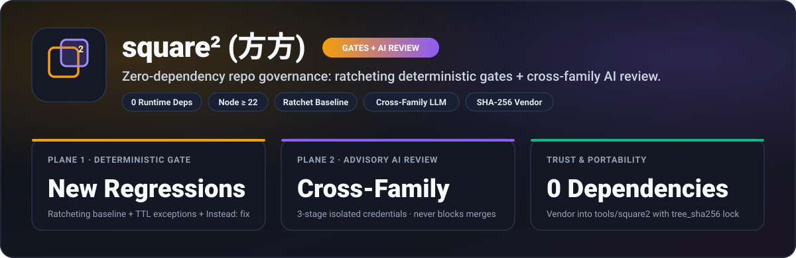
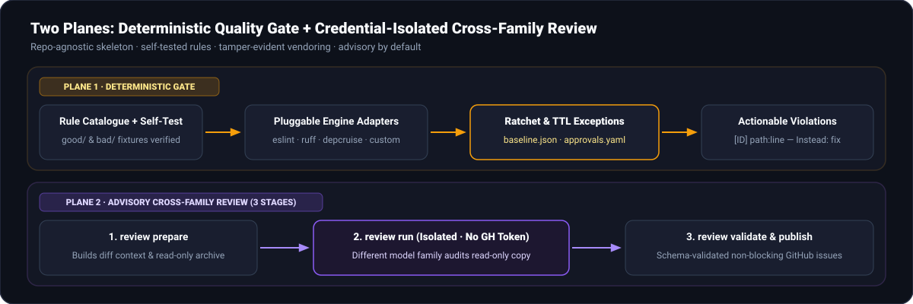

<p align="center">
  
</p>

<p align="center">
  <a href="LICENSE"></a>
  = 22" />
  
  
</p>

<p align="center">
  <a href="docs/consumer-guide.md"><strong>Consumer Guide</strong></a> ·
  <a href="docs/dune-rules.md"><strong>Gate Rules</strong></a> ·
  <a href="docs/trust-model.md"><strong>Trust Model</strong></a> ·
  <a href="docs/auth.md"><strong>Auth</strong></a> ·
  <a href="templates/consumer/"><strong>Templates</strong></a> ·
  <a href="https://github.com/Overbaker/square2/discussions"><strong>Discussions</strong></a>
</p>

---

**square² (方方)** is a **zero-dependency**, repo-agnostic governance skeleton (Node ≥ 22, MIT) built around two non-blocking planes: a **deterministic ratcheting quality gate** that fails only on *new* regressions with concrete `Instead:` fixes, and an **advisory cross-family AI code review** where a different model family audits commits in a credential-isolated read-only copy.

## Two-Plane Architecture

<p align="center">
  
</p>

## Quick Start

```sh
npm install
npm run typecheck
npm test
```

Drop-in consumer workflows, `.square2/` configs, and pre-push hooks live in [`templates/consumer/`](templates/consumer/).

## CLI Commands

Run from your repo root (or pass `--root <dir>`). Exit codes: `0` pass · `1` violations · `2` tool/config/vendor error.

| Command | Purpose |
|---|---|
| `square2 check [--only <ids>] [--format text\|github] [--report <path>] [--base <sha>] [--rev <sha>]` | Self-test enabled rules, subtract `.square2/baseline.json` + live exceptions, print `[ID] path:line — Instead: …`. Enforces baseline ratchet & exception immutability with `--base`. |
| `square2 selftest [--only <ids>]` | Verify every enabled rule fires on `.square2/fixtures/<id>/bad/` and stays silent on `good/`. |
| `square2 baseline show \| shrink \| grow --approval <id>` | Inspect, shrink resolved entries, or grow baseline citing `.square2/approvals.yaml`. |
| `square2 exceptions lint [--base <sha>]` | Validate `.square2/exceptions.yaml` TTLs and immutability. |
| `square2 vendor --from <path\|git-url> --ref <tag> [--into <dir>]` | Copy square² into `tools/square2/` and pin `tree_sha256` in `.square2/lock.json`. |
| `square2 replay --rule <id> (--commit <sha> \| --since <days>) [--out <file>]` | Replay a candidate rule on git history in a temporary worktree before enabling it. |
| `square2 review prepare \| run \| validate \| publish \| guard-env` | 3-stage daily cross-family review (`prepare` → read-only `run` with no GH token → `validate`/`publish`). |
| `square2 publish-gate [--report <path>] [--branch <name>] [--test]` | Open GitHub issues for new gate violations on the configured branch. |
| `square2 budget` | Track month-to-date Actions minutes against your threshold. |
| `square2 config get <key>` | Print a scalar from `.square2/config.yaml`. |

<details>
<summary><strong>Configuration (<code>.square2/config.yaml</code>) & Pluggable Engines</strong></summary>

```yaml
approvers:
  - some-login
max_exception_ttl_days: 90
require_provenance: false   # true: every enabled rule needs born_from + replay report
generated:
  - apps/web/generated/**
engines:
  ruff:
    command: [uv, run, --project, python, ruff]
  depcruise:
    config: .dependency-cruiser.cjs
  eslint:
    config: eslint.config.mjs
```

Supported engines: `depcruise`, `eslint`, `ruff`, built-in `suppressions`, and custom `command` (JSON-lines `{"path","line","subject"}`). `<ids>` accepts globs like `S2-DEP-*,S2-SUPPRESS-*`; `--square2-dir` / `SQUARE2_DIR` points to an alternate catalogue.

</details>

<details>
<summary><strong>Tamper-Evident Vendoring & CI Agnosticism</strong></summary>

- **Vendoring**: `square2 vendor` pins `tree_sha256` in `.square2/lock.json`. Any unexpected modification exits `2` with `[S2-VENDOR-TAMPERED]`.
  Threat model: detects accidental edits of the vendored copy; a committer can always change policy, which review of the commit must catch.
- **CI Agnosticism**: `.github/workflows/ci.yml` runs `typecheck`, `test`, and an optional agnosticism grep using `SQ2_FORBIDDEN_PATTERN` (skipped on forks) so the public skeleton never leaks consumer names.

</details>

<details>
<summary><strong>FAQ</strong></summary>

- **Does square² block PR merges?** Both planes are advisory by default (`v0.1`): square² reports violations and opens issues without blocking merges.
- **Why split AI review into 3 steps?** Keeping `review run` strictly read-only with **zero GitHub token** ensures an untrusted model call cannot mutate repository state or exfiltrate write credentials.
- **Why zero runtime dependencies?** Vendoring square² into `tools/square2/` stays fast, auditable, and immune to supply-chain churn.

</details>

---

Licensed under **MIT** ([LICENSE](LICENSE)). See [CONTRIBUTING.md](CONTRIBUTING.md) to contribute.
